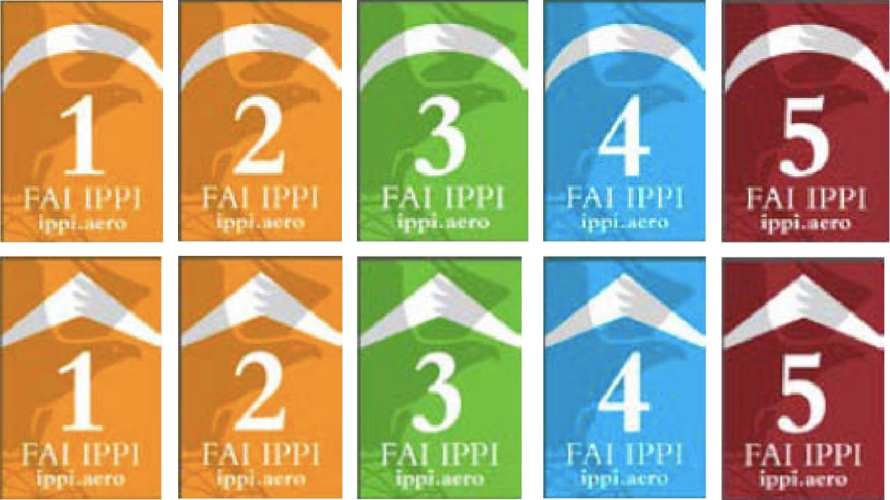

The Club operates under a regime of strict rules whose purpose is two-fold:

1. To keep every pilot safe and happy.
2. To keep the site open and safe from legal repercussions.

For the benefit of every pilot, we kindly ask you to learn the rules and to respect them.

## Licenses and certifications

### Approved organizations and rating systems

The Club formally recognizes the validity of licenses issued by the following organizations:

| Organization | Country | Website |
| --- | --- | --- |
| FAI | International | [fai.org](https://www.fai.org/) |
| APPI | International | [flyappi.org](https://flyappi.org/) |

<!--
| USHPA | United States | [ushpa.org](https://www.ushpa.org/) |
| HPAC/ACVL | Canada | [hpac.ca](https://hpac.ca/) |
| SAFA | Australia | [safa.asn.au](https://www.safa.asn.au/) |
| Austrian Aeroclub | Austria | [aeroclub.at](https://www.aeroclub.at/) |
| FBVL | Belgium | [fbvl.be](https://federation.fbvl.be/) |
| CBVL | Brazil | [cbvl.esp.br](https://www.cbvl.esp.br/) |
| Fedeaéreos | Colombia | [fedeaereos.org](https://fedeaereos.org/) |
| FFVL | France | [ffvl.fr](https://federation.ffvl.fr/) |
| DHV | Germany | [dhv.de](https://www.dhv.de/) |
| IHPA | Ireland | [ihpa.ie](https://www.ihpa.ie/) |
| FIVL | Italy | [fivl.it](http://www.fivl.it/) |
| JHF | Japan | [jhf.hangpara.or.jp](http://jhf.hangpara.or.jp/) |
| KNVvL | Netherlands | [knvvl.nl](https://www.knvvl.nl/) |
| NZHGPA | New Zealand | [nzhgpa.org.nz](https://nzhgpa.org.nz/) |
| NLF | Norway | [nlf.no](https://nlf.no/) |
| FPVL | Portugal | [fpvl.pt](https://www.fpvl.pt/) |
| SAHPA | South Africa | [sahpa.co.za](http://www.sahpa.co.za/) |
| RFAE | Spain | [rfae.es](https://rfae.es/) |
| SPA | Sweden | [paragliding.se](https://paragliding.se/) |
| SHV/FSVL | Switzerland | [shv-fsvl.ch](https://www.shv-fsvl.ch/) |
| BHPA | United Kingdom | [bhpa.co.uk](https://www.bhpa.co.uk/) |
-->

The Club accepts IPPI Cards and any license that explicitly states the pilot's IPPI or SafePro rating, regardless of the issuing country or organization.

Your IPPI level may appear on your pilot license as one of these stickers:

If your license was issued by an organization not included in the list above, and it does not state your IPPI or SafePro rating — and is therefore not formally recognized by the Club — you may petition the Board of Directors at [info@clubpenon.org](mailto:info@clubpenon.org).

<!--
### Exception for hang gliding pilots

For the sport of hang gliding, the Club formally recognizes the validity of licenses issued by the [AVLM](https://avlm.com.mx/). Holders of AVLM hang gliding licenses are granted the same rights, privileges, and responsibilities as holders of equivalent licenses from other recognized certification systems.
-->

## Pilot ratings and associated club rules

:::note
Please read this section carefully: the pilot rating that appears on your license defines the rules under which you must operate.
:::

### Definitions

- **Authorized Guide:** A pilot who has been formally authorized by the Club's Technical Committee to work as a Guide.
- **Authorized Instructor:** A pilot who has been formally authorized by the Club's Technical Committee to work as an Instructor, is a current Club Member, and holds a valid membership.
- **Authorized Tandem Pilot:** A pilot who has been formally authorized by the Club's Technical Committee to work as a Tandem Pilot, is a current Club Member, and holds a valid membership.
- **Club Member:** A pilot accepted as an Associate during a General Assembly of the Club.
- **Responsibility:** Instructors and Guides assume responsibility for their student's safety by co-signing their Release of Liability form, and are expected to supervise them at all times.

<!--
### Clarifications

- When "IPPI 1, APPI 1" is indicated, only APPI licenses or licenses bearing the IPPI logo with a rating of 1 are accepted. Equivalent licenses are not recognized.
- When "APPI Pro Tandem, or equivalent" is indicated, APPI Pro Tandem licenses are accepted, as well as any license with an equivalent rating issued by an organization formally recognized by the Club.
-->

### Pilots flying solo

#### Without license

- You must fly under the Responsibility of an Authorized Instructor.
- The Authorized Instructor is responsible for evaluating your skill rating and ensuring that you follow the corresponding rules.

#### IPPI 1, APPI 1

- You must fly under the Responsibility of an Authorized Instructor.
- You must fly with a red ribbon clearly visible to other pilots.
- From November 1st to June 1st: you cannot fly between 11 am and 4 pm.

#### IPPI 2, APPI 2

- You must fly under the Responsibility of an Authorized Instructor or Authorized Guide.
- You must fly with a red ribbon clearly visible to other pilots.
- From November 1st to June 1st: you cannot fly between 11 am and 4 pm.

#### IPPI 3, APPI 3

Rules differ for visitors and local pilots:
- **Visitor:** You must fly under the Responsibility of an Authorized Instructor or Authorized Guide.
- **Club Member:** No restrictions.

#### IPPI 4, APPI 4 · IPPI 5, APPI 5

- No restrictions.

### Pilots flying tandem

:::note
Licenses must be issued by an organization formally recognized by the Club in order to qualify as being "equivalent" to an IPPI or APPI rating.
:::

#### Without license

- You are prohibited from flying tandem.

#### IPPI 5, APPI 5

- You must fly under the Responsibility of an Authorized Instructor.
- Your passengers must hold a minimum certification of IPPI 2 or APPI 2.
- You are prohibited from charging passengers.

#### APPI Non-commercial Tandem "In Progress", or equivalent

- Your passengers must hold a minimum certification of IPPI 2 or APPI 2.
- You are prohibited from charging passengers.

#### IPPI 6, APPI Non-commercial Tandem, or equivalent · APPI Commercial Tandem, or equivalent

- **Visitor:** You are prohibited from charging passengers.
- **Authorized Tandem Pilot:** You are permitted to charge passengers.

#### Tandem license from the Club de Vuelo y Vela de Valle de Bravo

You can fly solo as well as fly non-commercial tandems without having to pay the entrance fee.
To fly commercial tandems you must become a Club Member, hold a valid membership, and be formally authorized by the Club's Technical Committee.

### Pilots giving instruction

<!--
#### Without license

- You are prohibited from providing instruction.

#### APPI Assistant Instructor, APPI Instructor, APPI Master Instructor, or equivalent

- **Visitor:** You may provide instruction to pilots certified at a minimum of IPPI 2 or APPI 2.
- **Club Member:** You may provide instruction to pilots of any level.
-->

Only Authorized Instructors are allowed to give instruction to student pilots who do not hold a license or hold a license with an IPPI 1 or equivalent rating.

### Pilots guiding other pilots

Only Authorized Guides are allowed to guide pilots who hold a license with an IPPI 2, IPPI 3, or equivalent ratings.

If you are not an Authorized Guide you are only permitted to guide pilots who are allowed to fly without supervision; see [Pilots Flying Solo](#pilots-flying-solo).

## Flight-related rules

### Mandatory equipment

- Helmet
- Reserve parachute
- Radio

### Turning direction

For the safety of every pilot in the air, the Club imposes a turning direction in the entire Peñón area, and especially in the house thermal and around launch.

- On **even** days: turn to the right.
- On **odd** days: turn to the left.

### Restricted hours

From November 1st to June 1st, between 11 am and 4 pm, some flight restrictions apply; see [Pilot ratings and associated club rules](#pilot-ratings-and-associated-club-rules).

### Top landing

**Top landing is prohibited in December and January**.  
**Top landing is prohibited on tandem flights all year;** see [Fines and sanctions](/en/rules/fines/).

Solo pilots may top land:
- From February to November, and
- When no pilot is waiting to launch.

The pilot attempting the top landing bears sole responsibility in case of an accident.

### Kiting

The Club allows kiting (ground handling) in the landing zone under the following conditions:

- **Pilots on approach always have priority.** Pilots who are kiting must watch for anyone on final or on approach at all times, and must bring their wing down and give way immediately.
- **The landing zone is first and foremost for landing.** Kiting is a secondary activity and must not interfere with flight operations.
- **Safety is non-negotiable.** Any pilot who, through omission or negligence while kiting, puts others at risk will face disciplinary action.
