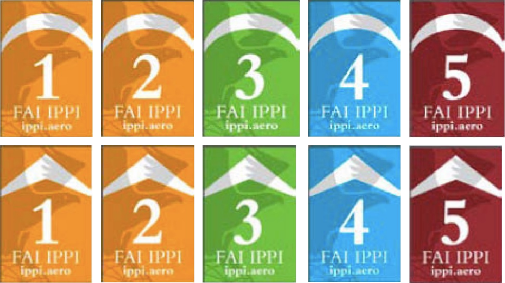

These rules keep pilots safe and happy, and keep the site open and protected from legal repercussions. We kindly ask you to respect them.

## Licenses and certifications

### Approved organizations

The Club formally recognizes the validity of licenses issued by the following organizations:

| Organization | Country | Website |
| --- | --- | --- |
| FAI | International | [fai.org](https://www.fai.org/) |
| APPI | International | [flyappi.org](https://flyappi.org/) |
| USHPA | United States | [ushpa.org](https://www.ushpa.org/) |
| HPAC/ACVL | Canada | [hpac.ca](https://hpac.ca/) |
| FFVL | France | [ffvl.fr](https://federation.ffvl.fr/) |
| DHV | Germany | [dhv.de](https://www.dhv.de/) |
| FIVL | Italy | [fivl.it](http://www.fivl.it/) |
| SHV/FSVL | Switzerland | [shv-fsvl.ch](https://www.shv-fsvl.ch/) |
| BHPA | United Kingdom | [bhpa.co.uk](https://www.bhpa.co.uk/) |

<!--
| USHPA | United States | [ushpa.org](https://www.ushpa.org/) |
| HPAC/ACVL | Canada | [hpac.ca](https://hpac.ca/) |
| SAFA | Australia | [safa.asn.au](https://www.safa.asn.au/) |
| Austrian Aeroclub | Austria | [aeroclub.at](https://www.aeroclub.at/) |
| FBVL | Belgium | [fbvl.be](https://federation.fbvl.be/) |
| CBVL | Brazil | [cbvl.esp.br](https://www.cbvl.esp.br/) |
| Fedeaéreos | Colombia | [fedeaereos.org](https://fedeaereos.org/) |
| FFVL | France | [ffvl.fr](https://federation.ffvl.fr/) |
| DHV | Germany | [dhv.de](https://www.dhv.de/) |
| IHPA | Ireland | [ihpa.ie](https://www.ihpa.ie/) |
| FIVL | Italy | [fivl.it](http://www.fivl.it/) |
| JHF | Japan | [jhf.hangpara.or.jp](http://jhf.hangpara.or.jp/) |
| KNVvL | Netherlands | [knvvl.nl](https://www.knvvl.nl/) |
| NZHGPA | New Zealand | [nzhgpa.org.nz](https://nzhgpa.org.nz/) |
| NLF | Norway | [nlf.no](https://nlf.no/) |
| FPVL | Portugal | [fpvl.pt](https://www.fpvl.pt/) |
| SAHPA | South Africa | [sahpa.co.za](http://www.sahpa.co.za/) |
| RFAE | Spain | [rfae.es](https://rfae.es/) |
| SPA | Sweden | [paragliding.se](https://paragliding.se/) |
| SHV/FSVL | Switzerland | [shv-fsvl.ch](https://www.shv-fsvl.ch/) |
| BHPA | United Kingdom | [bhpa.co.uk](https://www.bhpa.co.uk/) |
-->

The Club accepts IPPI Cards and any license that explicitly states the pilot's IPPI or SafePro rating, regardless of the issuing country or organization.

Your IPPI level may appear on your pilot license as one of these stickers:

If your license was issued by an organization not included in the list above, and it does not state your IPPI or SafePro rating — and is therefore not formally recognized by the Club — you may petition the Board of Directors at [info@clubpenon.org](mailto:info@clubpenon.org).

<!--
### Exception for hang gliding pilots

For the sport of hang gliding, the Club formally recognizes the validity of licenses issued by the [AVLM](https://avlm.com.mx/). Holders of AVLM hang gliding licenses are granted the same rights, privileges, and responsibilities as holders of equivalent licenses from other recognized certification systems.
-->

## Pilot ratings and associated club rules

:::note
Please read this section carefully: the pilot rating that appears on your license defines the rules under which you must operate.
:::

### Definitions

- **Authorized:** A pilot who has been formally authorized by the Club's Technical Committee to operate as a Tandem Pilot, Guide, Assistant, or Instructor.
- **Club Member:** A pilot accepted as an Associate during a General Assembly of the Club.
- **Responsibility:** Instructors and Guides assume responsibility for their students' safety by co-signing their Release of Liability form, and are expected to supervise them at all times.

### Clarifications

We use a combination of the [IPPI](https://www.fai.org/page/civl-ippi-card) and [APPI](https://flyappi.org/education_system/) systems when referring to pilot ratings. These ratings are meant to serve as a reference. Equivalent ratings are accepted as long as they are issued by an [organization formally recognized by the Club](#approved-organizations).

<!--
- When "IPPI 1, APPI 1" is indicated, only APPI licenses or licenses bearing the IPPI logo with a rating of 1 are accepted. Equivalent licenses are not recognized.
- When "APPI Pro Tandem, or equivalent" is indicated, APPI Pro Tandem licenses are accepted, as well as any license with an equivalent rating issued by an organization formally recognized by the Club.
-->

### Pilots flying solo

:::tip
- If you are rated IPPI 1 or don't have a pilot license, you need to hire an [Authorized Instructor](/en/lists/authorized-pilots/#instructors).
- If you are rated IPPI 2 or 3, you need to hire an [Authorized Guide](/en/lists/authorized-pilots/#guides) or [Authorized Instructor](/en/lists/authorized-pilots/#instructors) (with one [exception](#ippi-3)).
- If you are rated IPPI 4 or 5, you can fly on your own.
:::

#### Without license

- You must fly under the Responsibility of an [Authorized Instructor](/en/lists/authorized-pilots/#instructors).
- The [Authorized Instructor](/en/lists/authorized-pilots/#instructors) is responsible for evaluating your skill rating and ensuring that you follow the corresponding rules.

#### IPPI 1

- You must fly under the Responsibility of an [Authorized Instructor](/en/lists/authorized-pilots/#instructors).
- You must fly with a red ribbon clearly visible to other pilots.
- From November 1st to June 1st: you cannot fly between 11 am and 4 pm.

#### IPPI 2

- You must fly under the Responsibility of an [Authorized Instructor](/en/lists/authorized-pilots/#instructors) or [Authorized Guide](/en/lists/authorized-pilots/#guides).
- You must fly with a red ribbon clearly visible to other pilots.
- From November 1st to June 1st: you cannot fly between 11 am and 4 pm.

#### IPPI 3

Rules differ for visitors and local pilots:
- **Visitor:** You must fly under the Responsibility of an [Authorized Instructor](/en/lists/authorized-pilots/#instructors) or [Authorized Guide](/en/lists/authorized-pilots/#guides).
- **Club Member:** No restrictions, **but you fly under your own responsibility**.

#### IPPI 4 or IPPI 5

- No restrictions, **but you fly under your own responsibility**.

### Pilots flying tandem

:::tip
- To fly non-commercial tandems, you need the corresponding tandem certification (see below).
- To fly commercial tandems, you must be a Club Member holding a valid membership, and be formally authorized by the Club's Technical Committee as an [Authorized Tandem Pilot](/en/lists/authorized-pilots/#tandem-pilots).
:::

#### Without license

- You are prohibited from flying tandem.

#### IPPI 5

- You must fly under the Responsibility of an [Authorized Instructor](/en/lists/authorized-pilots/#instructors).
- Your passengers must hold a minimum certification of IPPI 2.
- You are prohibited from charging passengers.

#### APPI Non-commercial Tandem "In Progress"

- Your passengers must hold a minimum certification of IPPI 2.
- You are prohibited from charging passengers.

#### APPI Non-commercial Tandem or IPPI 6

- **Visitor:** You are prohibited from charging passengers.
- **[Authorized Tandem Pilot](/en/lists/authorized-pilots/#tandem-pilots):** You are permitted to charge passengers.

#### APPI Commercial Tandem

- **Visitor:** You are prohibited from charging passengers.
- **[Authorized Tandem Pilot](/en/lists/authorized-pilots/#tandem-pilots):** You are permitted to charge passengers.

#### Tandem license from the Club de Vuelo y Vela de Valle de Bravo

You are subject to the same rules as every other pilot in regard to licenses and certifications. The exceptions that apply to you concern only the payment of the entrance pass. Please refer to the dedicated section about the agreement between the clubs on the [Other rules](/en/rules/other/#agreement-with-the-club-de-vuelo-y-vela-de-valle-de-bravo) page.

### Pilots giving instruction

Only [Authorized Instructors](/en/lists/authorized-pilots/#instructors) are allowed to give instruction to pilots who do not have a license, or whose license is rated IPPI 1 or equivalent.

To become an Authorized Instructor, you must:

- be a Club Member,
- hold a valid Instructor Membership, and
- be formally authorized by the Club's Technical Committee.

[Authorized Assistants](/en/lists/authorized-pilots/#assistants) may provide instruction under the supervision of an Authorized Instructor, who retains full responsibility for the students' safety and for the instruction given.

### Pilots guiding other pilots

Only [Authorized Guides](/en/lists/authorized-pilots/#guides) are allowed to guide pilots who hold a license with an IPPI 2, IPPI 3, or equivalent rating.

Pilots who do not have a license, or whose license is rated IPPI 1 or equivalent, may not be guided. They must be supervised by an [Authorized Instructor](/en/lists/authorized-pilots/#instructors).

If you are not an [Authorized Guide](/en/lists/authorized-pilots/#guides) you are only permitted to guide pilots who are allowed to fly without supervision (i.e. IPPI 4+ rated pilots); see [Pilots flying solo](#pilots-flying-solo).

## Flight-related rules

### Mandatory equipment

- Helmet
- Reserve parachute
- Radio

### Turning direction

For the safety of every pilot in the air, the Club imposes a turning direction in the entire Peñón area, and especially in the house thermal and around launch.

- On **even** days: turn to the right.
- On **odd** days: turn to the left.

### Restricted hours

From November 1st to June 1st, between 11 am and 4 pm, some flight restrictions apply; see [Pilot ratings and associated club rules](#pilot-ratings-and-associated-club-rules).

### Top landing

**Top landing is prohibited in December and January**.  
**Top landing is prohibited on tandem flights all year;** see [Sanctions](/en/rules/fines/).

Solo pilots may top land:
- From February to November, and
- When no pilot is waiting to launch.

The pilot attempting the top landing bears sole responsibility in case of an accident.

### Kiting

The Club allows kiting (ground handling) in the landing zone under the following conditions:

- **Pilots on approach always have priority.** Pilots who are kiting must watch for anyone on final or on approach at all times, and must bring their wing down and give way immediately.
- **The landing zone is first and foremost for landing.** Kiting is a secondary activity and must not interfere with flight operations.
- **Safety is non-negotiable.** Any pilot who, through omission or negligence while kiting, puts others at risk will face disciplinary action.
