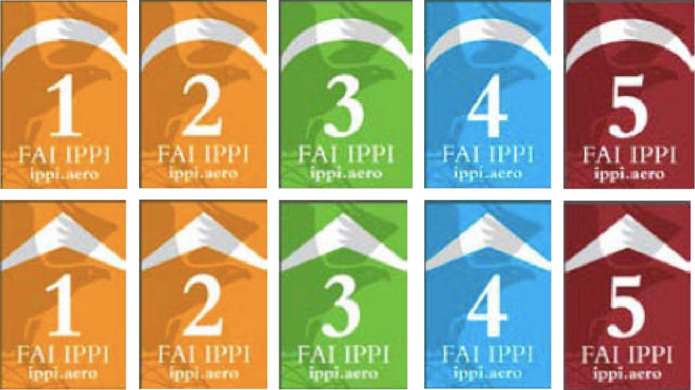

El Club opera bajo un régimen de reglas estrictas con un doble propósito:

1. Que todos los pilotos vuelen seguros y contentos.
2. Mantener el sitio abierto y a salvo de repercusiones legales.

Por el bien de todos los pilotos, te pedimos que conozcas las reglas y las respetes.

## Licencias y certificaciones

:::note
Lee esta sección con atención: tu licencia de piloto determina qué reglas te aplican.
:::

### Organizaciones y sistemas de niveles aprobados

El Club reconoce formalmente la validez de las licencias emitidas por las siguientes organizaciones:

| Organización | País | Sitio web |
| --- | --- | --- |
| FAI | Internacional | [fai.org](https://www.fai.org/) |
| APPI | Internacional | [flyappi.org](https://flyappi.org/) |
| SAFA | Australia | [safa.asn.au](https://www.safa.asn.au/) |
| Austrian Aeroclub | Austria | [aeroclub.at](https://www.aeroclub.at/) |
| FBVL | Bélgica | [fbvl.be](https://federation.fbvl.be/) |
| CBVL | Brasil | [cbvl.esp.br](https://www.cbvl.esp.br/) |
| HPAC/ACVL | Canadá | [hpac.ca](https://hpac.ca/) |
| Fedeaéreos | Colombia | [fedeaereos.org](https://fedeaereos.org/) |
| FFVL | Francia | [ffvl.fr](https://federation.ffvl.fr/) |
| DHV | Alemania | [dhv.de](https://www.dhv.de/) |
| IHPA | Irlanda | [ihpa.ie](https://www.ihpa.ie/) |
| FIVL | Italia | [fivl.it](http://www.fivl.it/) |
| JHF | Japón | [jhf.hangpara.or.jp](http://jhf.hangpara.or.jp/) |
| KNVvL | Países Bajos | [knvvl.nl](https://www.knvvl.nl/) |
| NZHGPA | Nueva Zelanda | [nzhgpa.org.nz](https://nzhgpa.org.nz/) |
| NLF | Noruega | [nlf.no](https://nlf.no/) |
| FPVL | Portugal | [fpvl.pt](https://www.fpvl.pt/) |
| SAHPA | Sudáfrica | [sahpa.co.za](http://www.sahpa.co.za/) |
| RFAE | España | [rfae.es](https://rfae.es/) |
| SPA | Suecia | [paragliding.se](https://paragliding.se/) |
| SHV/FSVL | Suiza | [shv-fsvl.ch](https://www.shv-fsvl.ch/) |
| BHPA | Reino Unido | [bhpa.co.uk](https://www.bhpa.co.uk/) |
| USHPA | Estados Unidos | [ushpa.org](https://www.ushpa.org/) |

El Club acepta las tarjetas IPPI y cualquier licencia que indique explícitamente el nivel IPPI o SafePro del piloto, sin importar el país u organización que la emita.

Tu nivel IPPI puede aparecer en tu licencia de piloto con una de estas calcomanías:

Si tu licencia fue emitida por una organización que no está en la lista anterior y no indica tu nivel IPPI o SafePro —y, por lo tanto, no está reconocida formalmente por el Club—, puedes solicitar una excepción al Consejo Directivo o al Comité de Instructores.

### Excepción para pilotos de ala delta

Para el ala delta, el Club reconoce formalmente la validez de las licencias emitidas por la [AVLM](https://avlm.com.mx/). Los titulares de licencias de ala delta de la AVLM tienen los mismos derechos, privilegios y responsabilidades que los titulares de licencias equivalentes de otros sistemas de certificación reconocidos.

## Niveles de piloto y reglas del Club asociadas

El nivel de piloto que aparece en tu licencia define las reglas bajo las que debes operar.

### Definiciones

- **Instructor Certificado:** Piloto con licencia de instructor asistente, instructor o instructor máster emitida por una organización reconocida formalmente por el Club.
- **Miembro del Club:** Piloto aceptado como Asociado en una Asamblea General del Club.
- **Responsabilidad:** El instructor supervisor debe firmar una carta responsiva en la que reconoce y acepta formalmente la responsabilidad de la supervisión y la seguridad del piloto.

### Aclaraciones

- Cuando se indica «IPPI 1, APPI 1», solo se aceptan licencias APPI o licencias con el logotipo IPPI y nivel 1. No se reconocen licencias equivalentes.
- Cuando se indica «APPI Pro Tandem, o equivalente», se aceptan las licencias APPI Pro Tandem, así como cualquier licencia de nivel equivalente emitida por una organización reconocida formalmente por el Club.

### Pilotos en vuelo monoplaza

#### Sin licencia

- Debes volar bajo la Responsabilidad de un Instructor Certificado que sea Miembro del Club.
- El Instructor Certificado y Miembro del Club es responsable de evaluar tu nivel y de asegurarse de que sigas las reglas correspondientes.

#### IPPI 1, APPI 1

- Debes volar bajo la Responsabilidad de un Instructor Certificado que sea Miembro del Club.
- Debes volar con un listón rojo claramente visible para los demás pilotos.
- Del 1 de noviembre al 1 de junio: no puedes volar entre las 11:00 y las 16:00.

#### IPPI 2, APPI 2

- Debes volar bajo la Responsabilidad de un Instructor Certificado.
- Debes volar con un listón rojo claramente visible para los demás pilotos.
- Del 1 de noviembre al 1 de junio: no puedes volar entre las 11:00 y las 16:00.

#### IPPI 3, APPI 3

- **Miembro del Club:** Sin restricciones.
- **Visitante:** Debes volar bajo la Responsabilidad de un Instructor Certificado.

#### IPPI 4, APPI 4 · IPPI 5, APPI 5

- Sin restricciones.

### Pilotos en vuelo tándem

#### Sin licencia

- Tienes prohibido volar en tándem.

#### IPPI 5, APPI 5

- Debes volar bajo la Responsabilidad de un Instructor Certificado que sea Miembro del Club.
- Tus pasajeros deben tener como mínimo una certificación IPPI 2 o APPI 2.
- Tienes prohibido cobrar a los pasajeros.

#### APPI Non-commercial Tandem «In Progress», o equivalente

- Tus pasajeros deben tener como mínimo una certificación IPPI 2 o APPI 2.
- Tienes prohibido cobrar a los pasajeros.

#### IPPI 6, APPI Non-commercial Tandem, o equivalente · APPI Commercial Tandem, o equivalente

- **Miembro del Club:** Puedes cobrar a los pasajeros.
- **Visitante:** Tienes prohibido cobrar a los pasajeros.

#### Licencia de tándem del Club de Vuelo y Vela de Valle de Bravo

:::caution[Borrador — elegir una opción]
Opción A:

- Sujeto a las reglas del Convenio firmado entre ambos clubes.

Opción B:

- **Miembro del Club:** Puedes cobrar a los pasajeros.
- **Visitante:** Sujeto a las reglas del Convenio firmado entre ambos clubes.
:::

### Pilotos que imparten instrucción

#### Sin licencia

- Tienes prohibido impartir instrucción.

#### APPI Assistant Instructor, APPI Instructor, APPI Master Instructor, o equivalente

- **Miembro del Club:** Puedes impartir instrucción a pilotos de cualquier nivel.
- **Visitante:** Puedes impartir instrucción a pilotos con una certificación mínima de IPPI 2 o APPI 2.

## Kiteo

El Club autoriza el kiteo en el aterrizaje bajo las siguientes condiciones:

- **La prioridad corresponde siempre al piloto en aproximación.** Los pilotos que estén kiteando deberán mantenerse atentos en todo momento a quienes se encuentren en final o en aproximación, y deberán bajar su vela y ceder el paso de inmediato.
- **El aterrizaje es, ante todo, una pista de aterrizaje.** El kiteo es una actividad secundaria y no debe interferir con las operaciones de vuelo.
- **La seguridad es innegociable.** Todo piloto que, por omisión o negligencia durante el kiteo, ponga en riesgo la integridad de terceros se expondrá a sanciones disciplinarias.

## Top landing

**Está prohibido el top landing en vuelo tándem.** Esta falta se sanciona con una multa de 1500 pesos mexicanos.

Para pilotos monoplaza se permite bajo las siguientes reglas:

- Solo se permite de febrero a noviembre (prohibido en diciembre y enero).
- Solo cuando no haya ningún piloto por despegar.
- La responsabilidad es exclusiva del piloto que aterriza.
