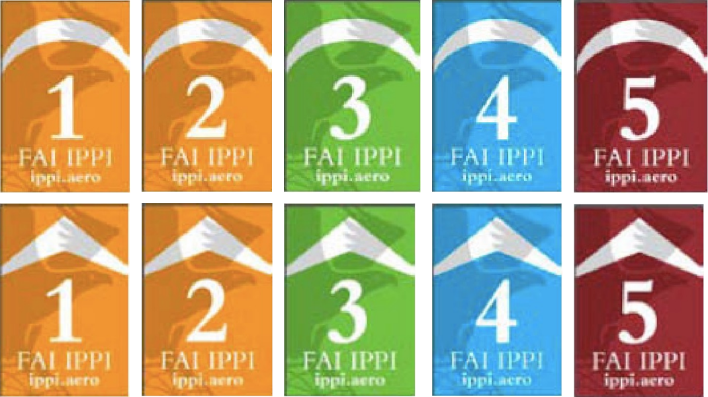

**Lee esta página con atención:** el nivel de piloto que aparece en tu licencia define las reglas bajo las que debes operar.

:::note
Para referirnos a los niveles de piloto usamos una combinación de los sistemas [IPPI](https://www.fai.org/page/civl-ippi-card) y [APPI](https://flyappi.org/education_system/). Estos niveles sirven como referencia. Se aceptan niveles equivalentes siempre que estén emitidos por una [organización reconocida formalmente por el Club](#organizaciones-aprobadas).
:::

<!--
- Cuando se indica «IPPI 1, APPI 1», solo se aceptan licencias APPI o licencias con el logotipo IPPI y nivel 1. No se reconocen licencias equivalentes.
- Cuando se indica «APPI Pro Tandem, o equivalente», se aceptan las licencias APPI Pro Tandem, así como cualquier licencia de nivel equivalente emitida por una organización reconocida formalmente por el Club.
-->

## Niveles de piloto y reglas del Club asociadas

### Pilotos en vuelo monoplaza

:::tip
- Si tienes nivel IPPI 1 o no tienes licencia de piloto, debes contratar a un [Instructor Autorizado](/es/lists/authorized-pilots/#instructores).
- Si tienes nivel IPPI 2 o 3, debes contratar a un [Guía Autorizado](/es/lists/authorized-pilots/#guías) o [Instructor Autorizado](/es/lists/authorized-pilots/#instructores) (con una [excepción](#ippi-3)).
- Si tienes nivel IPPI 4 o 5, puedes volar por tu cuenta.
:::

#### Sin licencia

- Debes volar bajo la Responsabilidad de un [Instructor Autorizado](/es/lists/authorized-pilots/#instructores).
- El [Instructor Autorizado](/es/lists/authorized-pilots/#instructores) es responsable de evaluar tu nivel y de asegurarse de que sigas las reglas correspondientes.

#### IPPI 1

- Debes volar bajo la Responsabilidad de un [Instructor Autorizado](/es/lists/authorized-pilots/#instructores).
- Debes volar con un listón rojo claramente visible para los demás pilotos.
- Del 1 de noviembre al 1 de junio: no puedes volar entre las 11:00 y las 16:00.

#### IPPI 2

- Debes volar bajo la Responsabilidad de un [Instructor Autorizado](/es/lists/authorized-pilots/#instructores) o de un [Guía Autorizado](/es/lists/authorized-pilots/#guías).
- Debes volar con un listón rojo claramente visible para los demás pilotos.
- Del 1 de noviembre al 1 de junio: no puedes volar entre las 11:00 y las 16:00.

#### IPPI 3

Las reglas son distintas para visitantes y pilotos locales:
- **Visitante:** Debes volar bajo la Responsabilidad de un [Instructor Autorizado](/es/lists/authorized-pilots/#instructores) o de un [Guía Autorizado](/es/lists/authorized-pilots/#guías).
- **Asociado del Club:** Sin restricciones, **pero bajo tu propia responsabilidad**.

#### IPPI 4 o IPPI 5

- Sin restricciones, **pero bajo tu propia responsabilidad**.

### Pilotos en vuelo tándem

:::tip
- Para volar tándem no comercial, necesitas la certificación de tándem correspondiente (ver abajo).
- Para volar tándem comercial, debes ser Asociado del Club con tu membresía vigente y estar autorizado formalmente por el Comité Técnico del Club como [Piloto Tándem Autorizado](/es/lists/authorized-pilots/#pilotos-tándem).
:::

#### Sin licencia

- Tienes prohibido volar en tándem.

#### IPPI 5

- Debes volar bajo la Responsabilidad de un [Instructor Autorizado](/es/lists/authorized-pilots/#instructores).
- Tus pasajeros deben tener como mínimo una certificación IPPI 2.
- Tienes prohibido cobrar a los pasajeros.

#### APPI Non-commercial Tandem «In Progress»

- Tus pasajeros deben tener como mínimo una certificación IPPI 2.
- Tienes prohibido cobrar a los pasajeros.

#### APPI Non-commercial Tandem o IPPI 6

- **Visitante:** Tienes prohibido cobrar a los pasajeros.
- **[Piloto Tándem Autorizado](/es/lists/authorized-pilots/#pilotos-tándem):** Puedes cobrar a los pasajeros.

#### APPI Commercial Tandem

- **Visitante:** Tienes prohibido cobrar a los pasajeros.
- **[Piloto Tándem Autorizado](/es/lists/authorized-pilots/#pilotos-tándem):** Puedes cobrar a los pasajeros.

#### Licencia de tándem del Club de Vuelo y Vela de Valle de Bravo

Estás sujeto a las mismas reglas que todos los demás pilotos en cuanto a licencias y certificaciones. Las excepciones en tu caso se refieren únicamente al pago del pase de entrada. Consulta la sección dedicada al convenio entre los clubes en la página [Otras reglas](/es/rules/other/#convenio-con-el-club-de-vuelo-y-vela-de-valle-de-bravo).

### Pilotos que imparten instrucción

Solo los [Instructores Autorizados](/es/lists/authorized-pilots/#instructores) pueden impartir instrucción a pilotos que no tienen licencia, o cuya licencia tiene nivel IPPI 1 o equivalente.

Para ser Instructor Autorizado, debes:

- ser Asociado del Club,
- tener una Membresía de Instructor vigente, y
- ser autorizado formalmente por el Comité Técnico del Club.

Los [Asistentes Autorizados](/es/lists/authorized-pilots/#asistentes) pueden impartir instrucción bajo la supervisión de un Instructor Autorizado, quien conserva la responsabilidad plena por la seguridad de los alumnos y por la instrucción impartida.

### Pilotos que guían a otros pilotos

Solo los [Guías Autorizados](/es/lists/authorized-pilots/#guías) pueden guiar a pilotos con licencia de nivel IPPI 2, IPPI 3 o equivalente.

Los pilotos que no tienen licencia, o cuya licencia tiene nivel IPPI 1 o equivalente, no pueden ser guiados. Deben estar bajo la supervisión de un [Instructor Autorizado](/es/lists/authorized-pilots/#instructores).

Si no eres [Guía Autorizado](/es/lists/authorized-pilots/#guías), solo puedes guiar a pilotos que tienen permitido volar sin supervisión (es decir, pilotos con nivel IPPI 4+); consulta [Pilotos en vuelo monoplaza](#pilotos-en-vuelo-monoplaza).

### Definiciones

- **Autorizado:** Piloto autorizado formalmente por el Comité Técnico del Club para operar como Piloto Tándem, Guía, Asistente o Instructor.
- **Asociado del Club:** Piloto aceptado como Asociado en una Asamblea General del Club.
- **Responsabilidad:** Los Instructores y Guías asumen la responsabilidad de la seguridad de sus alumnos al firmar junto con ellos su carta responsiva, y deben supervisarlos en todo momento.

## Organizaciones aprobadas

El Club reconoce formalmente la validez de las licencias emitidas por las siguientes organizaciones:

| Organización | País | Sitio web |
| --- | --- | --- |
| FAI | Internacional | [fai.org](https://www.fai.org/) |
| APPI | Internacional | [flyappi.org](https://flyappi.org/) |
| USHPA | Estados Unidos | [ushpa.org](https://www.ushpa.org/) |
| HPAC/ACVL | Canadá | [hpac.ca](https://hpac.ca/) |
| FFVL | Francia | [ffvl.fr](https://federation.ffvl.fr/) |
| DHV | Alemania | [dhv.de](https://www.dhv.de/) |
| FIVL | Italia | [fivl.it](http://www.fivl.it/) |
| SHV/FSVL | Suiza | [shv-fsvl.ch](https://www.shv-fsvl.ch/) |
| BHPA | Reino Unido | [bhpa.co.uk](https://www.bhpa.co.uk/) |

<!--
| USHPA | Estados Unidos | [ushpa.org](https://www.ushpa.org/) |
| HPAC/ACVL | Canadá | [hpac.ca](https://hpac.ca/) |
| SAFA | Australia | [safa.asn.au](https://www.safa.asn.au/) |
| Austrian Aeroclub | Austria | [aeroclub.at](https://www.aeroclub.at/) |
| FBVL | Bélgica | [fbvl.be](https://federation.fbvl.be/) |
| CBVL | Brasil | [cbvl.esp.br](https://www.cbvl.esp.br/) |
| Fedeaéreos | Colombia | [fedeaereos.org](https://fedeaereos.org/) |
| FFVL | Francia | [ffvl.fr](https://federation.ffvl.fr/) |
| DHV | Alemania | [dhv.de](https://www.dhv.de/) |
| IHPA | Irlanda | [ihpa.ie](https://www.ihpa.ie/) |
| FIVL | Italia | [fivl.it](http://www.fivl.it/) |
| JHF | Japón | [jhf.hangpara.or.jp](http://jhf.hangpara.or.jp/) |
| KNVvL | Países Bajos | [knvvl.nl](https://www.knvvl.nl/) |
| NZHGPA | Nueva Zelanda | [nzhgpa.org.nz](https://nzhgpa.org.nz/) |
| NLF | Noruega | [nlf.no](https://nlf.no/) |
| FPVL | Portugal | [fpvl.pt](https://www.fpvl.pt/) |
| SAHPA | Sudáfrica | [sahpa.co.za](http://www.sahpa.co.za/) |
| RFAE | España | [rfae.es](https://rfae.es/) |
| SPA | Suecia | [paragliding.se](https://paragliding.se/) |
| SHV/FSVL | Suiza | [shv-fsvl.ch](https://www.shv-fsvl.ch/) |
| BHPA | Reino Unido | [bhpa.co.uk](https://www.bhpa.co.uk/) |
-->

El Club acepta las tarjetas IPPI y cualquier licencia que indique explícitamente el nivel IPPI o SafePro del piloto, sin importar el país u organización que la emita.

Tu nivel IPPI puede aparecer en tu licencia de piloto con una de estas calcomanías:

Si tu licencia fue emitida por una organización que no está en la lista anterior y no indica tu nivel IPPI o SafePro —y, por lo tanto, no está reconocida formalmente por el Club—, puedes solicitar una excepción al Consejo Directivo en [info@clubpenon.org](mailto:info@clubpenon.org).

<!--
### Excepción para pilotos de ala delta

Para el ala delta, el Club reconoce formalmente la validez de las licencias emitidas por la [AVLM](https://avlm.com.mx/). Los titulares de licencias de ala delta de la AVLM tienen los mismos derechos, privilegios y responsabilidades que los titulares de licencias equivalentes de otros sistemas de certificación reconocidos.
-->
